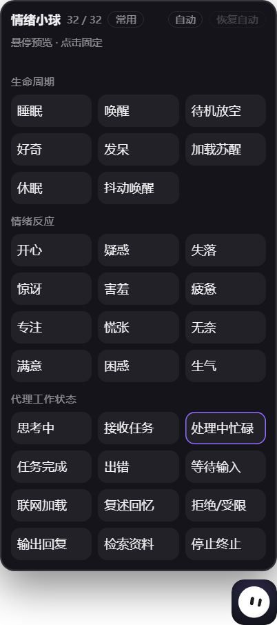

# dsh-emotion-ball

给 [DSH（DeepSeek Harness）](https://github.com/deepseek-ai) 加一颗住在桌面上的情绪小球：
它跟着 agent 的真实工作状态换表情——思考、检索、联网、出错、等你确认，都能看出来。

不是网页里的挂件，是一个**独立的透明置顶小窗**，停在你屏幕角落。



## 它做什么

| 操作 | 结果 |
|---|---|
| 单击小球 | 展开表情选择盘（16 个常用，可切 32 个全量） |
| 悬停格子 | 实时预览；点一下固定该表情（手动模式） |
| 拖动 | 移动位置，位置会记住；贴边时面板自动翻转，不会被屏幕裁掉 |
| 双击 | **看得见它**（窗口没被挡住）→ 最小化；**看不见它**（被别的窗口盖住 / 最小化 / 在托盘）→ 拉到最前面 / 拉起来 |
| 右键 | 眼神跟随开关、主题（跟随系统 / 深色 / 浅色）、低延迟模式（仅回退路径） |
| 任务完成 / 出错 | 右上角亮紫色 `!`；有问题等你回答时是 `?` |
| 你在 DSH 里点/滚/打字 | 角标算已读，自动消失 |

状态是从 DSH 的真实事件推出来的（`session/event`、`agent/status`、工具调用），
不是定时轮播：

```
31 接收任务 → 30 思考中 → 32 处理中 → 40 检索 / 36 联网
          → 33 完成（2s）→ 34 出错 / 35 等待确认 / 41 停止 / 38 拒绝
空闲时在 02 待机 / 03 好奇 / 04 发呆 / 19 满意 之间缓慢轮换
```

主题是双向同步的：球的菜单切主题会让整个 DSH 一起切（写进 DSH 的用户设置，
重启还在）；你在 DSH 别处改了主题，球也会跟着变。

## 安装

### 前置条件

| 需要 | 说明 |
|---|---|
| **Windows 10/11** | 目前只支持 Windows（双击最小化 / 前台判断走 Win32；解压用系统自带 `tar.exe`） |
| **DSH** | 桌面版，且插件系统可用 |

**不需要预装 dsh-pet 或任何 Electron。** 第一次启用时插件会自己下载一份 Electron
运行时（约 138 MB，国内镜像优先、失败自动切官方），存在
`%USERPROFILE%\.dsh\emotion-ball-runtime\`，之后只认自己这份——
删掉 dsh-pet 不会影响小球。下载进度会显示在 DSH 窗口右下角，失败可以点重试。

### 步骤

1. 把本仓库放到任意目录，例如 `D:\plugins\dsh-emotion-ball`
2. 打开 DSH → 侧边栏「插件」→ 安装/添加插件 → 选择上面这个目录
3. 启用后，屏幕右下角出现小球（约 1 秒内）

想用自己已有的 Electron 也可以：设环境变量 `DSH_EMOTION_BALL_ELECTRON` 指向 `electron.exe`，
插件就不会再下载。

## 内存占用

Chromium 窗口的固有开销，不是漏内存：

| | 私有内存 | 说明 |
|---|---|---|
| Electron 窗口（4 个进程） | ≈125 MB | 主进程 + 渲染 + GPU + 网络服务，Chromium 的最小配置 |
| 窗口操作小 exe | ≈3 MB | `toggle-helper.exe`，首次运行用系统 `csc.exe` 编译，之后常驻 |

双击延迟（同一台机器实测）：

| 场景 | 耗时 |
|---|---|
| 可见且在前台 → 最小化 | ≈60–70 ms |
| 被别的窗口盖住 → 置顶唤醒 | ≈140 ms |
| 最小化 / 托盘 → 恢复 | ≈215 ms |

插件本体只有 **260 KB**。

## 已知限制

- **仅 Windows**：Linux/macOS 上桌面窗口起不来
- **首次要下载 138 MB**：运行时归插件自己所有（≈350 MB 解压后），不想下载可以设 `DSH_EMOTION_BALL_ELECTRON` 复用已有 Electron
- **单显示器假设**：多显示器 / 高 DPI 下的位置记忆可能偏移几像素
- **`set_emotion` 工具还在**：每次请求约 +228 输入 token，不用可以删掉工具定义

## 工作原理

```
DSH Host（插件宿主半侧 index.js）
  ├── lib/state.js  状态机：把会话事件折成「现在在干什么」
  ├── 127.0.0.1:8766  静态服务 + /state /manual /theme /focus /badge /emotions.json
  └── 启动时 spawn helper 进程，停用时 kill

Electron helper（helper/main.js）
  ├── 44×44 透明无边框置顶窗口，加载 ball.html
  ├── 40ms 读一次光标，只在球/面板上解除鼠标穿透
  ├── 单击展开（窗口 = 面板 + 球，自动选展开方向）
  ├── 双击 → Win32 最小化/还原/置顶（常驻小 exe 调 user32，没有 PowerShell 冷启动）
  └── 400ms 轮询 /state（角标亮着时 120ms）
```

`PLAN-desktop-ball.md` 里有更细的设计记录、取舍，以及一路踩过的坑（值得一读）。

## 许可

**分两层，请注意：**

- 本项目自己的代码（`index.js`、`client.js`、`lib/`、`helper/`、`test/`）：**MIT**（见 `LICENSE`）
- `assets/emotion-ball/` 的球形象与引擎：来自 *Emotion Ball* 项目，遵循
  **Emotion Ball Community License**（见 `assets/emotion-ball/LICENSE`）：
  **球形象的视觉设计仅限个人学习研究，禁止商用，且作者不提供商业授权。**

细节和"想商用怎么办"写在 [THIRD-PARTY.md](THIRD-PARTY.md)。

## 开发

`sh
# 状态机断言（改 lib/state.js 后跑）
node test/host-state.mjs

# 页面内联脚本语法检查（改 ball.html 后必跑，曾经因为多一个 }); 白屏）
node test/html-scripts.mjs assets/emotion-ball/ball.html
`

调试模式：给 helper 加 `--dev=1`（或环境变量 `DSH_EMOTION_BALL_DEV=1`）会打开
`%APPDATA%\dsh-emotion-ball-helper\input.log`，里面记录鼠标命中、双击命令、
窗口操作的往来回包，排查问题时很有用。

## 致谢

- 球的形象与表情引擎：[Emotion Ball](https://github.com/sam70361) by sam70361
- 运行在 [DeepSeek Harness](https://github.com/deepseek-ai) 上
